

# الفيزياء السادس العلمي 3D

  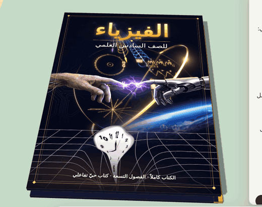

كتاب فيزياء ثلاثي الأبعاد تفاعلي لطلاب **الصف السادس العلمي** في العراق.
يُفتح الكتاب على مكتب افتراضي. في كل درس يتنبّأ الطالب أولاً، ثم يقرأ، ثم يجرّب الظاهرة بيده في مشهد ثلاثي الأبعاد، ثم يحل مثال الكتاب خطوة بخطوة.

**Developed by: Hassan salman** — Intensive Care Unit Nurse, Al-Najaf Teaching Hospital
[hassanaii.lovable.app](https://hassanaii.lovable.app) · [github.com/3h0ll7](https://github.com/3h0ll7)

---

## المحتوى

| الفصل | الموضوع | عدد الدروس |
|---|---|---|
| الأول | المتسعات | 10 |
| الثاني | الحث الكهرومغناطيسي | 13 |
| الثالث | التيار المتناوب | 9 |
| الرابع | الموجات الكهرومغناطيسية | 8 |
| الخامس | البصريات الفيزيائية | 7 |
| السادس | الفيزياء الحديثة | 8 |
| السابع | إلكترونيات الحالة الصلبة | 8 |
| الثامن | الأطياف الذرية والليزر | 9 |
| التاسع | الفيزياء النووية | 9 |
| **المجموع** | | **81** |

## المميزات

- **خمس خطوات لكل درس:** اقرأ · تنبّأ (مع لسان يُرفع لكشف الجواب) · جرّب · المعادلة والمصطلحات · مثال الكتاب محلولاً خطوة بخطوة.
- **مشاهد ثلاثية الأبعاد تفاعلية** بمؤشرات وأزرار، مع شاشات قياس وقراءات حيّة.
- **اختبار نهاية لكل فصل:** 99 سؤالاً من أسئلة «اختر العبارة الصحيحة» في الكتاب، مع شرح لكل إجابة ومراجعة للأخطاء.
- **حفظ التقدم:** علامة «أتممتُ الدرس» وشريط تقدم لكل فصل وللكتاب كله.
- **بحث داخل الكتاب** يتجاهل التشكيل واختلاف الهمزات والتاء المربوطة.
- **التحكم بالمشهد:** دوران 360°، وتكبير وتصغير، وتحريك بإصبعين على الأجهزة اللوحية.
- **حجم خط قابل للتعديل**، ووضع ليلي، وتصميم يعمل على الهاتف والجهاز اللوحي والحاسوب.
- **لون ثابت لكل مفهوم** في الكتاب كله: الشحنة الموجبة، والسالبة، والمجال الكهربائي، والمغناطيسي، والطاقة.

## جولة مصوّرة

### التجربة بيدك
حرّك المؤشر فتتغير التجربة وقراءاتها مباشرة:

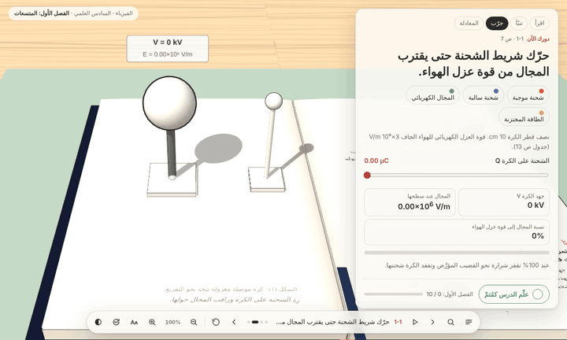

### من الدروس

<table>
<tr>
<td align="center" width="50%">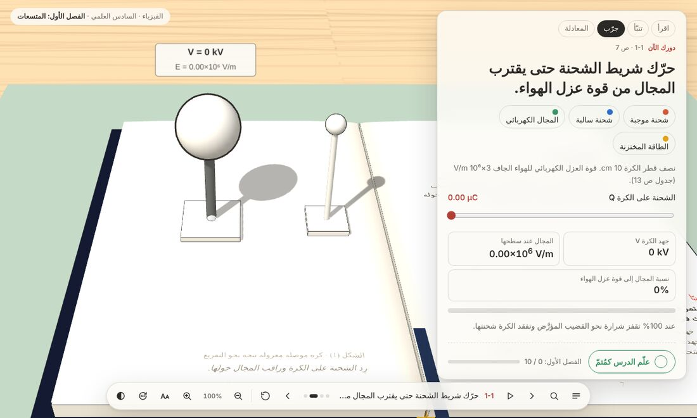 الفصل الأول · المتسعة</td>
<td align="center" width="50%">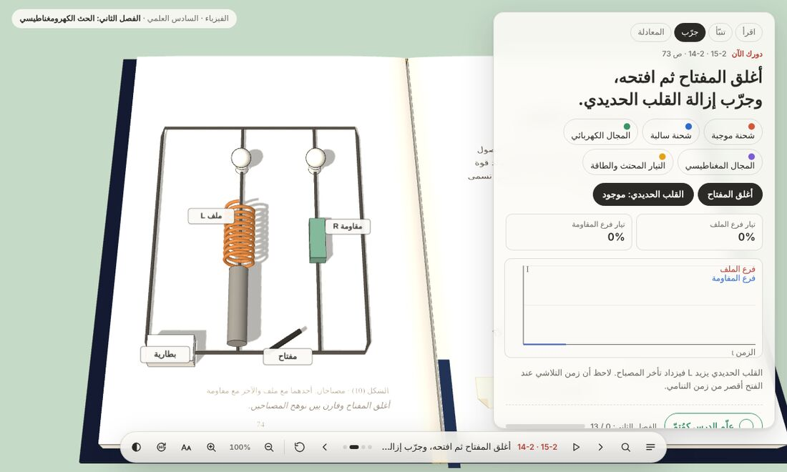 الفصل الثاني · المحاثة والحث الذاتي</td>
</tr>
<tr>
<td align="center">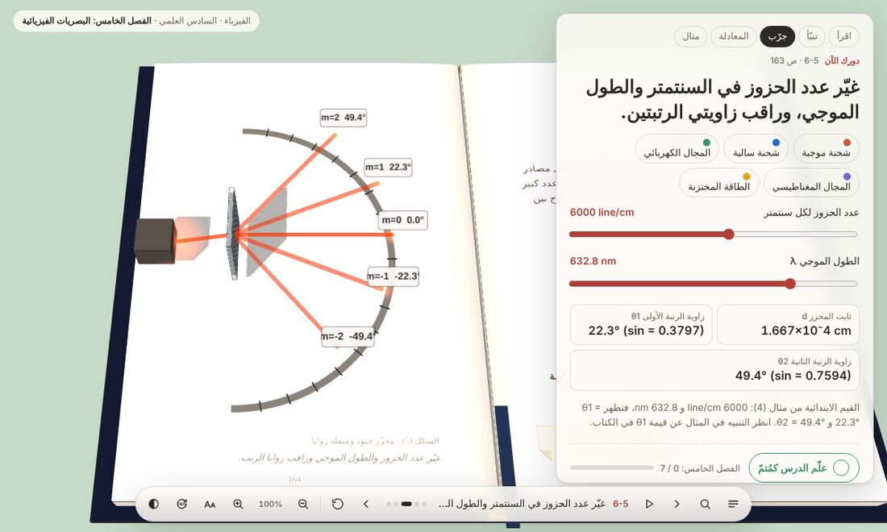 الفصل الخامس · محزز الحيود</td>
<td align="center">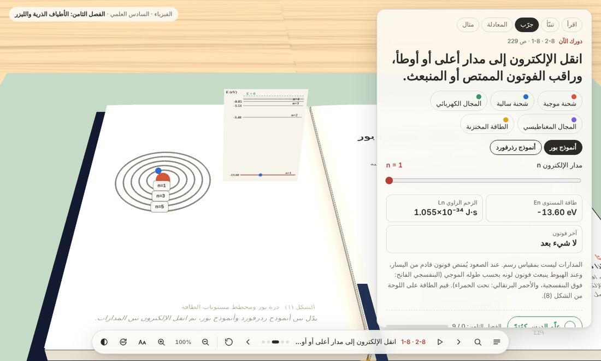 الفصل الثامن · أنموذج بور</td>
</tr>
<tr>
<td align="center">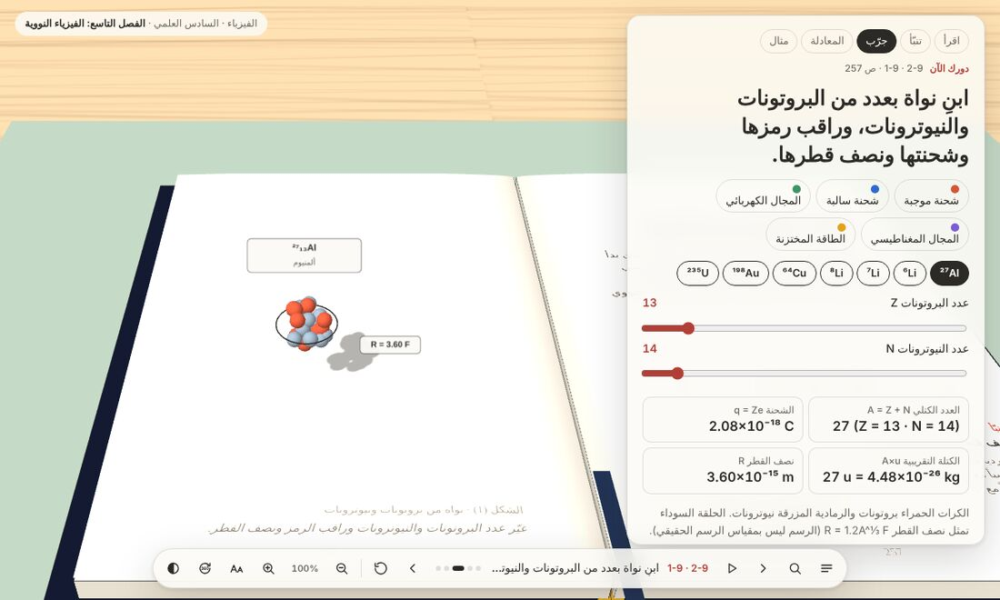 الفصل التاسع · تركيب النواة</td>
<td align="center">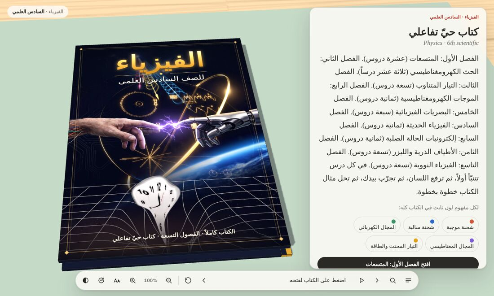 الغلاف وبطاقة الفصول</td>
</tr>
<tr>
<td align="center">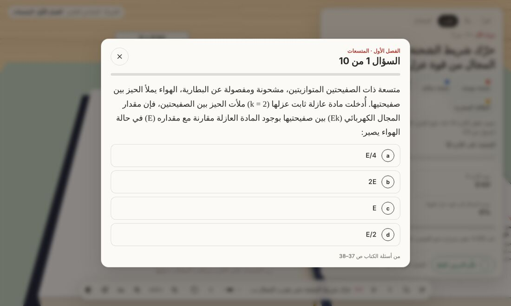 اختبار نهاية الفصل</td>
<td align="center">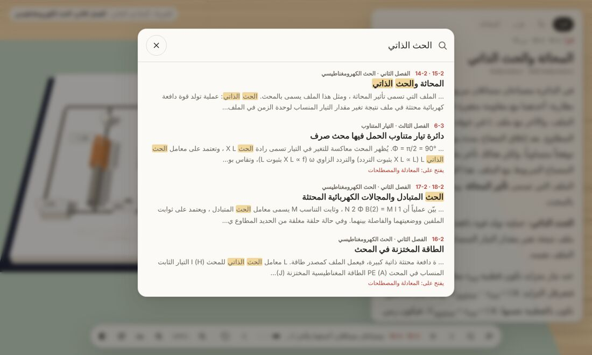 البحث داخل الكتاب</td>
</tr>
</table>

### على الهاتف والجهاز اللوحي

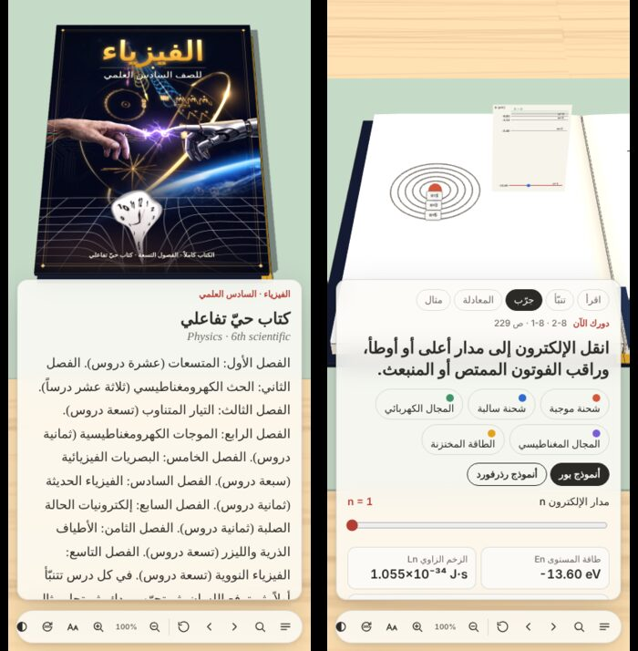

## خارطة الطريق

- [x] الكتاب كاملاً: تسعة فصول
- [x] اختبارات نهاية الفصول
- [x] حفظ التقدم والبحث والتكبير والدوران
- [ ] التسجيل برقم الهاتف ورمز تحقق
- [ ] الاشتراك: الفصل الأول مجاني، وبقية الفصول باشتراك
- [ ] الدفع بالدينار العراقي: بطاقات ماستر كارد وفيزا، وكي كارد، وزين كاش
- [ ] لوحة إدارة للمشتركين والإيرادات وأكواد الخصم
- [ ] حل مسائل نهاية كل فصل خطوة بخطوة

## ملاحظة حول المحتوى

يعتمد ترتيب الدروس وأمثلتها وأسئلتها على منهج الفيزياء للصف السادس العلمي الصادر عن وزارة التربية العراقية. أما المشاهد التفاعلية والشروح والاختبارات التفاعلية فهي من تطوير صاحب المشروع.

---

## English summary

**Sixth Grade Physics 3D** is an interactive 3D physics textbook for Iraqi 6th-grade scientific-track students: 9 chapters and 81 lessons, each with predict, read, try, equation and worked-example steps. It also has end-of-chapter quizzes (99 questions), progress tracking, in-book search, 360° rotation, zoom and two-finger pan.

## Build with Lovable

This project is connected to [Lovable](https://lovable.dev). Continue developing it in the [Lovable editor](https://lovable.dev/projects/1441a7e8-b27a-4313-abab-b47ac295e97f). Every change made in Lovable is committed to this repository, and pushes to `main` sync back into Lovable.
